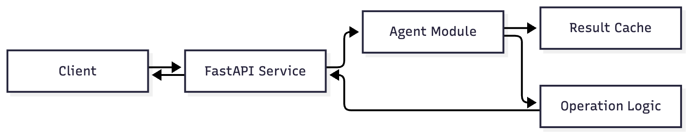
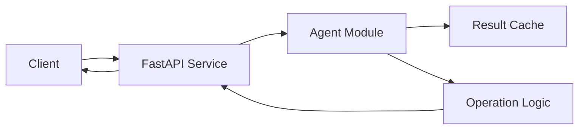

# Rolelever

Orchestrate specialized AI agents to execute complex, multi-step tasks with improved accuracy and modularity.

# TextProcessor MVP

A simple FastAPI service that processes text (uppercase, lowercase, reverse).

## Usage

```bash
pip install -r requirements.txt
uvicorn main:app --reload
```

## Demo

```bash
python -c "from main import demo; print(demo())"
```

## Architecture



<details>
<summary>Mermaid source</summary>



</details>
